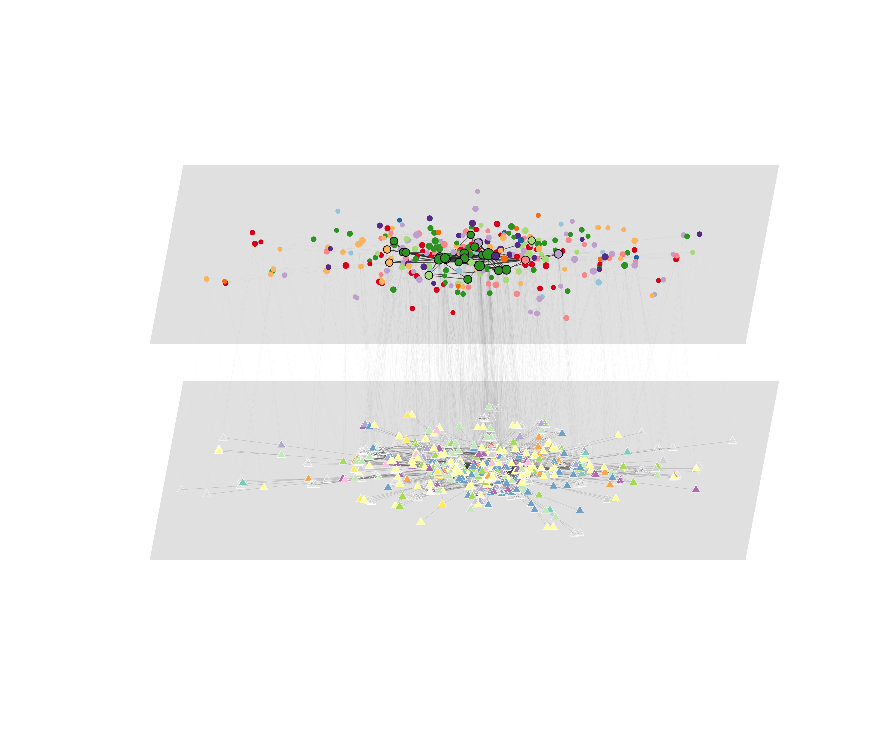

```{r setup, include=FALSE}
knitr::opts_chunk$set(
  echo = TRUE,
  message = FALSE,
  warning = FALSE,
  fig.width = 10,
  fig.height = 8,
  dpi = 300
)
```

# Overview

This document builds a visualization of the rap samples that Jenn Lena used in her dissertation and subsequent *Poetics* paper -@lena2004. Mark Pachucki provided the raw files that I am working from as part of a replication package for their related co-authored later *Poetics* paper -@lena2013.

```{r setup, include=FALSE}
knitr::opts_chunk$set(
  echo = TRUE,
  message = FALSE,
  warning = FALSE,
  fig.width = 10,
  fig.height = 8,
  dpi = 300
)
```

Right now, I'm working in the old "RapSamplesBackbone.Rmd" file to build out what's going here. Then as chunks work, porting them in for this as a "final" version.

# Overview

This document builds a visualization of the rap samples that Jenn Lena used in her dissertation and subsequent *Poetics* paper -@lena2004. Mark Pachucki provided the raw files that I am working from as part of a replication package for their related co-authored later *Poetics* paper -@lena2013.


## Setup 

Just packages, data, and re-labeling to get things started.

```{r packages}
library(dplyr)
library(tidyr)
library(igraph)
library(ggraph)
library(ggplot2)
library(scales)
library(purrr)
library(tibble)
library(rlang)
library(backbone)
library(patchwork)
library(RColorBrewer)

df <- readRDS("data/JL_samples.rds")
```

Just to clarify what's in that file:
| var name | brief derscription |
|---|---|
| `src_id` | source/sample song ID |
| `src_gen` | source/sample genre |
| `src_art` | source/sample artist label |
| `src_sng` | source/sample song title |
| `tar_id` | target/rap song ID |
| `tar_art` | target/rap artist label |
| `tar_sng` | target/rap song title |
| `tar_sub` | target/rap song sub-genre |
| `yr` | year |
| `art_tar` | target/rap artist ID |
| `art_src` | source/sample artist ID |


We'll convert those to *slightly* more informative variable names; typing efficiency be damned, mental space is too precious.

```{r standardize-data, eval=T}
samp <- df %>%
  transmute(
## sampling details
    rap_song_id = tar_id,
    rap_artist_id = art_tar,
    rap_artist = tar_art,
    rap_genre = tar_sub, 
    rap_song = tar_sng,
    year = as.integer(yr),
## sampled details
    sampled_song_id = src_id,
    sampled_artist_id = art_src,
    sampled_artist = src_art,
    sampled_song = src_sng,
    sampled_genre = as.character(src_gen)
  ) 
```

## The "raw" samples network

We're going to first build a bipartite incidence matrix of:

- **rap (sampling) **songs** on the rows** by
- **sampled *artists* on the columns**

Note these are weighted, because there are times where the same song multiply samples the same artist (in fact several 3 times!).

```{r build-incidence}

##  first as a graph
g <- graph_from_data_frame(
  data.frame(from = samp$rap_song_id, to = samp$sampled_artist_id), directed = FALSE)

## converting to 2-mode
V(g)$type <- V(g)$name %in% samp$rap_song_id
## collapsing multiple ties to edge weights
E(g)$weight <- 1 #needs a base
gw <- igraph::simplify(g, remove.multiple = TRUE, remove.loops = TRUE,
  edge.attr.comb = list(weight = "sum", .default = "ignore"))


## adding year as an *edge* attribute
edge_lookup <- samp %>%
  distinct(rap_song_id, sampled_artist_id, .keep_all = TRUE) %>%
  select(rap_song_id, sampled_artist_id, year) %>%
  # igraph stores as character, so making merge-able
  mutate(
    rap_song_id = as.character(rap_song_id),
    sampled_artist_id = as.character(sampled_artist_id)
  )
edges_joined <- igraph::as_data_frame(gw, what = "edges") %>%
  left_join(edge_lookup, by = c("from" = "rap_song_id", "to" = "sampled_artist_id"))
E(gw)$year <- edges_joined$year


## let's reattach the nodal attributes for potential use later
sampled_artist_attributes <- samp %>%
  select(sampled_artist_id, sampled_artist, sampled_genre) %>%
  distinct(sampled_artist_id, .keep_all = TRUE)
# I'm not sure how much we're going to use the sampling side here, but just in case, those too.
rap_song_attributes <- samp %>%
  select(rap_song_id, rap_artist_id, rap_artist, rap_genre, rap_song, year) %>%
  distinct(rap_song_id, .keep_all = TRUE)

V(gw)$artist <- ifelse(
  V(gw)$type, 
  rap_song_attributes$rap_artist[match(V(gw)$name, rap_song_attributes$rap_song_id)],
  sampled_artist_attributes$sampled_artist[match(V(gw)$name, sampled_artist_attributes$sampled_artist_id)]
)

# I can't imagine I'm going to use this in any plots, but it doesn't hurt to carry it.
V(gw)$song_title <- ifelse(
  V(gw)$type,
  rap_song_attributes$rap_song[match(V(gw)$name, rap_song_attributes$rap_song_id)],
  NA # doesn't apply to sampled artists
)
# Duplicate of edge attribute above, but I'm not positive which way I'll use it.
V(gw)$year <- ifelse(
  V(gw)$type,
  rap_song_attributes$year[match(V(gw)$name, rap_song_attributes$rap_song_id)],
  NA # doesn't apply to sampled artists
)

V(gw)$rap_artist_id <- ifelse(
  V(gw)$type,
  rap_song_attributes$rap_artist_id[
    match(V(gw)$name, rap_song_attributes$rap_song_id)
  ],
  NA # doesn't apply to sampled artists
)

############ Genres #################
# This one's key for the analyses here
# collapsing the broad genre categories to the analytic set
sampled_artist_attributes <- sampled_artist_attributes %>%
  mutate(
   new_genre = case_when(
      sampled_genre %in% c(2,3) ~ "blues", # + country (N=1)
      sampled_genre == 10 ~ "jazz",
      sampled_genre %in% c(1, 6, 18, 19) ~ "pop & rock", # + alt (N=7) + singer/songwriter (3) + folk (2)
      sampled_genre %in% c(4,23) ~ "disco", # + dance (15)
      sampled_genre %in% c(15,24) ~ "funk and r&b",
      sampled_genre == 16 ~ "soul",
      sampled_genre == 8 ~ "rap",
      sampled_genre %in% c(7,20,22) ~ "comedy & vocal",
      sampled_genre %in% c(11,17,21) ~ "reggae", # + latin & world (1 each)
      sampled_genre %in% c(5, 12, 14, 25) ~ "various"
    )) # 13, 9 are null

V(gw)$genre <- ifelse(
  !V(gw)$type,
  sampled_artist_attributes$new_genre[match(V(gw)$name, sampled_artist_attributes$sampled_artist_id)],
  NA # I don't want to have a genre attached to the sampling songs
)

# making it plotable
unique_genres <- sort(unique(na.omit(V(gw)$genre)))
genre_colors <- brewer.pal(
  length(unique_genres),
  "Set3"
)
names(genre_colors) <- unique_genres

V(gw)$genre_color <- ifelse(
  V(gw)$type,
  NA,
  genre_colors[V(gw)$genre]
)
# sampling songs (type = TRUE) become white; sampled artists color by genre

# Now for the sampling song genres
rap_song_attributes <- rap_song_attributes %>%
  mutate(
    new_genre = rap_genre
  )

V(gw)$rap_genre <- ifelse(
  V(gw)$type,
  rap_song_attributes$new_genre[
    match(V(gw)$name, rap_song_attributes$rap_song_id)
  ],
  NA # I don't want to have a rap genre attached to the sampled artists
)

# making it plotable
unique_rap_genres <- sort(unique(na.omit(V(gw)$rap_genre)))

rap_genre_colors <- c(
  brewer.pal(8, "Dark2"),
  brewer.pal(5, "Set1")
)

rap_genre_colors <- rap_genre_colors[seq_along(unique_rap_genres)]
names(rap_genre_colors) <- unique_rap_genres

V(gw)$rap_genre_color <- ifelse(
  V(gw)$type,
  rap_genre_colors[V(gw)$rap_genre],
  NA
)

rap_genre_labels <- c(
  B  = "booty",
  C  = "crossover",
  D  = "don",
  Ds = "dirty south",
  Eg = "east coast gangsta",
  G  = "g-funk",
  J  = "jazz",
  N  = "new jack swing",
  Pa = "parody",
  Pi = "pimp",
  Ra = "race",
  Ro = "rock",
  Wg = "west coast gangsta"
)

V(gw)$rap_genre_label <- unname(
  rap_genre_labels[V(gw)$rap_genre]
)

### Given a bunch of data manipulations above, I want to run one sanity check on something that was multiply assigned and thus "checkable" to ensure all was behaving as anticipated:
# dq_check <- igraph::as_data_frame(gw, what = "edges") %>%
#   mutate(node_year = V(gw)$year[match(from, V(gw)$name)])
# any(dq_check$year != dq_check$node_year) # is FALSE (as should be)

## and converting that to matrix form (for the backbone)
mw <- t(as.matrix(as_biadjacency_matrix(gw, attr = "weight")))

```

I have a few things there. In particular:

- mw - weighted sampling matrix (songs * artists)
- gw - weighted igraph object (bipartite)


```{r build-artxart}

## first as a graph, collapsing sampling songs to sampling artists
aw_edges <- igraph::as_data_frame(gw, what = "edges") %>%
  mutate(
    from_type = V(gw)$type[match(from, V(gw)$name)],
    to_type = V(gw)$type[match(to, V(gw)$name)],
    rap_artist_id = ifelse(
      from_type,
      V(gw)$rap_artist_id[match(from, V(gw)$name)],
      V(gw)$rap_artist_id[match(to, V(gw)$name)]
    ),
    sampled_artist_id = ifelse(
      from_type,
      to,
      from
    )
  ) %>%
  select(rap_artist_id, sampled_artist_id, weight)

aw <- graph_from_data_frame(
  aw_edges,
  directed = FALSE
)

## converting to 2-mode
V(aw)$type <- V(aw)$name %in% rap_song_attributes$rap_artist_id

## collapsing multiple ties to edge weights
aw <- igraph::simplify(
  aw,
  remove.multiple = TRUE,
  remove.loops = TRUE,
  edge.attr.comb = list(weight = "sum", .default = "ignore")
)

## let's reattach the nodal attributes already carried by gw
V(aw)$artist <- ifelse(
  V(aw)$type,
  rap_song_attributes$rap_artist[
    match(V(aw)$name, rap_song_attributes$rap_artist_id)
  ],
  sampled_artist_attributes$sampled_artist[
    match(V(aw)$name, sampled_artist_attributes$sampled_artist_id)
  ]
)

# This one's key for the analyses here
# use the collapsed source-genre classification already created above
V(aw)$genre <- ifelse(
  !V(aw)$type,
  sampled_artist_attributes$new_genre[
    match(V(aw)$name, sampled_artist_attributes$sampled_artist_id)
  ],
  NA # I don't want to have a genre attached to the sampling artists
)

# use the same sampled-artist genre colors already created above
V(aw)$genre_color <- ifelse(
  !V(aw)$type,
  genre_colors[V(aw)$genre],
  NA
)

## and converting that to matrix form
maw <- t(
  as.matrix(
    as_biadjacency_matrix(aw, attr = "weight")
  )
)

```

# Generating an *Exploratory* plot
I'm actually going to come back to this one last, ironically enough to the point of this exercise.

```{r plot-panelA, include=T}

# We're going to add sampling strength to the sampled artists as a nodal attribute:
all_gw_strengths <- strength(gw)
names(all_gw_strengths) <- V(gw)$name
V(gw)$degree <- all_gw_strengths[V(gw)$name]

vsize <- rep(2, vcount(gw))
names(vsize) <- V(gw)$name

sampled_artist_names <- V(gw)$name[!V(gw)$type]

vsize[sampled_artist_names] <- scales::rescale(
  log1p(all_gw_strengths[sampled_artist_names]),
  to = c(1, 4)
)

V(gw)$vsize <- vsize

source("src/igraph-triangles.R")
V(gw)$shape <- ifelse(V(gw)$type, "triangle", "circle")

# likely only going to plot the giant component, but let's carry the small ones just in case
components_list <- decompose(gw)
components_list <- components_list[
  order(sapply(components_list, vcount), decreasing = TRUE)
]

g_core <- components_list[[1]]
layout_core <- layout_with_fr(g_core)

# now we're going to strip off, and plot a grid of the smaller components
minor_components <- components_list[2:length(components_list)]
g_small <- disjoint_union(minor_components)

vsize_small <- vsize[V(g_small)$name] # just the ones that are still here

# some plotting config
all_coords_small <- matrix(
  0,
  nrow = vcount(g_small),
  ncol = 2
)
rownames(all_coords_small) <- V(g_small)$name
max_row_width <- 36  
padding <- 1.5       
current_x <- 0
current_y <- 0
max_height_in_row <- 0
  
# Step through each minor component to translate its true scale geometry
for (i in seq_along(minor_components)) {
  comp <- minor_components[[i]]
  comp_coords <- layout_with_fr(comp)
  comp_width <- max(comp_coords[, 1]) - min(comp_coords[, 1])
  comp_height <- max(comp_coords[, 2]) - min(comp_coords[, 2])
  comp_coords[, 1] <- comp_coords[, 1] - mean(comp_coords[, 1])
  comp_coords[, 2] <- comp_coords[, 2] - mean(comp_coords[, 2])
  if (current_x + comp_width > max_row_width && current_x > 0) {
    current_x <- 0
    current_y <- current_y - max_height_in_row - padding
    max_height_in_row <- 0
  }
  comp_coords[, 1] <- comp_coords[, 1] + current_x + (comp_width / 2)
  comp_coords[, 2] <- comp_coords[, 2] + current_y - (comp_height / 2)
  all_coords_small[V(comp)$name, ] <- comp_coords
  if (comp_height > max_height_in_row) {
    max_height_in_row = comp_height
  }
  current_x <- current_x + comp_width + padding
}

# colors for the sampled artists only;
# sampling songs remain white/neutral in the EDA plot
core_colors <- ifelse(
  V(g_core)$type,
  "white",
  V(g_core)$genre_color
)
small_colors <- ifelse(
  V(g_small)$type,
  "white",
  V(g_small)$genre_color
)

###### Actual plots
# giant component only
png(
  filename = "img/Lena_EDA-gconly.png",
  width = 2400,
  height = 2000,
  res = 300
)

par(mar = c(1, 1, 3, 1))

plot(
  g_core, 
  layout = layout_core, 
  vertex.size = V(g_core)$vsize, 
  vertex.label = NA,
  vertex.shape = c("circle", "triangle")[V(g_core)$type + 1],
  vertex.color = core_colors,
  margin = 0.15,
  edge.width = 0.5,
  edge.color = rgb(0.3, 0.3, 0.3, alpha = 0.15)
)

title(
  main = "Bipartite Sampling Graph",
  line = 2.5,
  cex.main = 1.5
)

title(
  main = "large component only",
  line = 1.2,
  cex.main = 1.0,
  font.main = 1
)

dev.off()

## w/ small components tiled
png(
  filename = "img/Lena_EDA-full.png",
  width = 3000,
  height = 1700,
  res = 300
)

par(
  mfrow = c(1, 2),
  mar = c(1, 1, 3, 1)
)

# giant component
plot(
  g_core, 
  layout = layout_core, 
  vertex.size = V(g_core)$vsize, 
  vertex.label = NA,
  vertex.shape = c("circle", "triangle")[V(g_core)$type + 1],
  vertex.color = core_colors,
  margin = 0.15,
  edge.width = 0.5,
  edge.color = rgb(0.3, 0.3, 0.3, alpha = 0.15)
)

# smaller components
plot(
  g_small, 
  layout = all_coords_small, 
  vertex.size = vsize_small, 
  vertex.label = NA,
  vertex.shape = c("circle", "triangle")[V(g_small)$type + 1],
  vertex.color = small_colors,
  margin = 0.15,
  edge.width = 0.6,
  edge.color = rgb(0.3, 0.3, 0.3, alpha = 0.3)
)

mtext(
  "Bipartite Rap Samples Network", 
  side = 3, 
  outer = TRUE, 
  line = 1, 
  cex = 1.5, 
  font = 2
)

par(mfrow = c(1, 1))

dev.off()


#### A third potential (artist-artist version)
V(aw)$shape <- ifelse(V(aw)$type, "triangle", "circle")

all_aw_degrees <- degree(aw)
names(all_aw_degrees) <- V(aw)$name

V(aw)$degree <- all_aw_degrees[V(aw)$name]

vsize_aw <- rep(2, vcount(aw))
names(vsize_aw) <- V(aw)$name

sampled_artist_names_aw <- V(aw)$name[!V(aw)$type]

vsize_aw[sampled_artist_names_aw] <- scales::rescale(
  log1p(all_aw_degrees[sampled_artist_names_aw]),
  to = c(1, 4)
)

V(aw)$vsize <- vsize_aw

# artist_deg <- degree(aw, v = V(aw)[!V(aw)$type])
# vsize <- rep(2, vcount(aw)) # fixing size for sampling nodes
# vsize[!V(aw)$type] <- scales::rescale(log1p(artist_deg), to = c(1, 4))
# names(vsize) <- V(aw)$name
# V(aw)$vsize <- vsize

plot(
  aw,
  vertex.size = V(aw)$vsize,
  vertex.label = NA,
  vertex.shape = c("circle", "triangle")[V(aw)$type + 1],
  vertex.color = ifelse(
    V(aw)$type,
    NA,
    V(aw)$genre_color
  ),
  margin = 0.15,
  edge.width = 0.5,
  edge.color = rgb(0.3, 0.3, 0.3, alpha = 0.15)
)

title(
  main = "Bipartite Artists Graph",
  line = 2.5,
  cex.main = 1.5
)
```
############################## 
# Generating a "hybrid" plot (I'll be coming back to this one)
############################## 

# First we need to identify the core set within the projected layer (keeping it separate to be able to later chunk out the analytic code from the plotting specific elements - I want to be able to simply import the results objects into the plotting steps--that latter part is what I'll likely post for the modeled viz paper.)

```{r coreset, include=T}

# sampled-artist projection
artist <- t(mw) %*% mw
diag(artist) <- 0

g_artist <- graph_from_adjacency_matrix(
  artist,
  mode = "undirected",
  weighted = TRUE,
  diag = FALSE
)

# identify the core sampled artists
# using the 95th-percentile sampling-strength heuristic
sampled_strength <- strength(
  gw,
  v = V(gw)[!V(gw)$type],
  weights = E(gw)$weight
)

core_threshold <- quantile(
  sampled_strength,
  0.95,
  na.rm = TRUE
)

core_names <- names(sampled_strength)[
  sampled_strength >= core_threshold
]

# extract the relationships among the core sampled artists
# this is the structural backbone used for the visualization
gas_core <- induced_subgraph(
  g_artist,
  vids = V(g_artist)[
    V(g_artist)$name %in% core_names
  ]
)
```


# Generating a modeled plot
```{r plot-modeled, include=T}
# First, let's produce a heuristic version.
## via sampling SONGS
w_art_vs <- t(mw) %*% mw # weighted sampled artist * sampled artist overlap
diag(w_art_vs) <- 0
gas <- graph_from_adjacency_matrix(w_art_vs, mode = "undirected", weighted = TRUE)

## via sampling ARTISTS
w_art_va <- t(maw) %*% maw # weighted sampled artist * sampled artist overlap
diag(w_art_va) <- 0
gaa <- graph_from_adjacency_matrix(w_art_va, mode = "undirected", weighted = TRUE)

# We're going to
#     1. identify the core here as sampled degree
#     2. then map the structure among that core as their weighted projections

sampled_swdegree <- colSums(mw)
sampled_awdegree <- colSums(maw)

# Create unweighted versions - this was just a sanity check, not something I'm actually using. 
# (It was a recognition that the colSums are equal on the weighted version, but not on the dichotomous.)
# umw <- mw
# umw[umw > 0] <- 1
# umaw <- maw
# umaw[umaw > 0] <- 1
# sampled_sudegree <- colSums(umw)
# sampled_audegree <- colSums(umaw)

V(gas)$degree <- sampled_swdegree
V(gaa)$degree <- sampled_awdegree


cdf_s <- ecdf(sampled_swdegree)
cdf_a <- ecdf(sampled_awdegree)

# Let's look at what threshold to use
(core_nodes_gas <- V(gas)[cdf_s(V(gas)$degree) >= 0.95])
(core_nodes_gaa <- V(gaa)[cdf_a(V(gaa)$degree) >= 0.95])

# These are equivalent since they're the weighted versions...
gas_core <- induced_subgraph(gas, vids = core_nodes_gas)
gaa_core <- induced_subgraph(gaa, vids = core_nodes_gaa)

```


___

# Temporary
Below here is a current version that's simply producing a strictly empirical parallel to the intended plot. This is what I'm including for the initial submission to the SN special issue. I'll update for any revisions.

```{r empirical-multilayer, include=T}

# ============================================================
# Empirical multilayer visualization
#
# gw       = observed sampling-song × sampled-artist network
# g_song   = sampling-song projection
# g_artist = sampled-artist projection
# gas_core = 26-node / 91-edge sampled-artist core
#
# The plot:
#   - two literal planes
#   - independent FR layouts within each layer
#   - neutral within-layer projected ties
#   - highly de-emphasized observed sampling ties between layers
#   - sampled-artist nodes sized by sampling strength
#   - sampled-artist core/backbone emphasized
#   - sampled-artist source genre shown on lower layer
#   - rap sub-genre shown on upper layer
#   - no node labels
# ============================================================


# ------------------------------------------------------------
# 1. BUILD THE TWO WITHIN-LAYER PROJECTIONS
# ------------------------------------------------------------

## building the two within-layer projections directly from the
## already-attributed bipartite graph

projections <- igraph::bipartite_projection(
  gw,
  multiplicity = TRUE,
  probe1 = V(gw)[!V(gw)$type][1],
  which = "both",
  remove.type = FALSE
)

# probe1 is a sampled artist, so the sampled-artist projection
# comes first and the sampling-song projection second
g_artist <- projections[[1]]
g_song   <- projections[[2]]


# ------------------------------------------------------------
# 2. REATTACH THE ATTRIBUTES ALREADY CARRIED BY gw
# ------------------------------------------------------------

# sampled-artist attributes
artist_lookup <- tibble(
  name = as.character(V(gw)$name),
  type = V(gw)$type,
  artist = V(gw)$artist,
  genre = V(gw)$genre,
  genre_color = V(gw)$genre_color
) %>%
  filter(!type) %>%
  distinct(name, .keep_all = TRUE)

V(g_artist)$artist <- artist_lookup$artist[
  match(V(g_artist)$name, artist_lookup$name)
]

V(g_artist)$genre <- artist_lookup$genre[
  match(V(g_artist)$name, artist_lookup$name)
]

V(g_artist)$genre_color <- artist_lookup$genre_color[
  match(V(g_artist)$name, artist_lookup$name)
]

# sampling-song attributes
song_lookup <- tibble(
  name = as.character(V(gw)$name),
  type = V(gw)$type,
  artist = V(gw)$artist,
  song_title = V(gw)$song_title,
  year = V(gw)$year,
  rap_genre = V(gw)$rap_genre,
  rap_genre_label = V(gw)$rap_genre_label,
  rap_genre_color = V(gw)$rap_genre_color
) %>%
  filter(type) %>%
  distinct(name, .keep_all = TRUE)

V(g_song)$artist <- song_lookup$artist[
  match(V(g_song)$name, song_lookup$name)
]

V(g_song)$song_title <- song_lookup$song_title[
  match(V(g_song)$name, song_lookup$name)
]

V(g_song)$year <- song_lookup$year[
  match(V(g_song)$name, song_lookup$name)
]

V(g_song)$rap_genre <- song_lookup$rap_genre[
  match(V(g_song)$name, song_lookup$name)
]

V(g_song)$rap_genre_label <- song_lookup$rap_genre_label[
  match(V(g_song)$name, song_lookup$name)
]

V(g_song)$rap_genre_color <- song_lookup$rap_genre_color[
  match(V(g_song)$name, song_lookup$name)
]


# ------------------------------------------------------------
# 3. HIGHLIGHT THE EMPIRICAL CORE ON THE SAMPLED-ARTIST LAYER
# ------------------------------------------------------------

# gas_core is the empirically identified core:
# 26 sampled artists with their 91 observed projected ties

core_names <- as.character(V(gas_core)$name)

V(g_artist)$is_core <- V(g_artist)$name %in% core_names


# identify which edges in the full sampled-artist projection
# belong to the core skeleton
core_edge_names <- apply(
  as_edgelist(gas_core, names = TRUE),
  1,
  function(x) paste(sort(x), collapse = "||")
)

artist_edge_names <- apply(
  as_edgelist(g_artist, names = TRUE),
  1,
  function(x) paste(sort(x), collapse = "||")
)

E(g_artist)$is_core_edge <- artist_edge_names %in% core_edge_names


# ------------------------------------------------------------
# 4. SAMPLING STRENGTH FOR SAMPLED-ARTIST NODE SIZE
# ------------------------------------------------------------

sampled_strength <- strength(
  gw,
  v = V(gw)[!V(gw)$type],
  weights = E(gw)$weight
)

names(sampled_strength) <- V(gw)$name

V(g_artist)$sampling_strength <- sampled_strength[
  V(g_artist)$name
]

# logged because sampling strength is strongly skewed
V(g_artist)$plot_size <- scales::rescale(
  log1p(V(g_artist)$sampling_strength),
  to = c(1, 4.5)
)


# ------------------------------------------------------------
# 5. RETAIN THE DIRECT OBSERVED INTER-LAYER TIES
# ------------------------------------------------------------

## these are the empirical sampling relationships themselves;
## weight is retained in the object but will not be encoded visually

interlayer_edges <- igraph::as_data_frame(
  gw,
  what = "edges"
) %>%
  mutate(
    from_type = V(gw)$type[
      match(from, V(gw)$name)
    ],
    to_type = V(gw)$type[
      match(to, V(gw)$name)
    ]
  ) %>%
  mutate(
    song = if_else(
      from_type,
      from,
      to
    ),
    sampled_artist = if_else(
      from_type,
      to,
      from
    )
  ) %>%
  select(
    song,
    sampled_artist,
    weight
  )


# ------------------------------------------------------------
# 6. INDEPENDENT FR LAYOUTS
# ------------------------------------------------------------

set.seed(123)

layout_song <- layout_with_fr(
  g_song,
  weights = E(g_song)$weight
)

layout_artist <- layout_with_fr(
  g_artist,
  weights = E(g_artist)$weight
)


# ------------------------------------------------------------
# 7. MAP EACH LAYOUT INTO ITS OWN LITERAL PLANE
# ------------------------------------------------------------

# The layout is normalized independently within each layer,
# then mapped into the interior of a parallelogram.

map_to_plane <- function(
  layout,
  xlim,
  ylim,
  pad = 0.08,
  shear = 0
) {
  
  x <- scales::rescale(
    layout[, 1],
    to = c(pad, 1 - pad)
  )
  
  y <- scales::rescale(
    layout[, 2],
    to = c(pad, 1 - pad)
  )
  
  plot_x <- xlim[1] +
    x * diff(xlim) +
    shear * (y - 0.5)
  
  plot_y <- ylim[1] +
    y * diff(ylim)
  
  cbind(
    x = plot_x,
    y = plot_y
  )
}


# upper = sampling-song layer
song_xy <- map_to_plane(
  layout_song,
  xlim = c(-4.0, 4.0),
  ylim = c(0.75, 2.45),
  shear = 0.45
)

# lower = sampled-artist layer
artist_xy <- map_to_plane(
  layout_artist,
  xlim = c(-4.0, 4.0),
  ylim = c(-2.45, -0.75),
  shear = -0.45
)


# ------------------------------------------------------------
# 8. COORDINATE TABLES
# ------------------------------------------------------------

song_xy <- tibble(
  name = V(g_song)$name,
  x = song_xy[, "x"],
  y = song_xy[, "y"]
)

artist_xy <- tibble(
  name = V(g_artist)$name,
  x = artist_xy[, "x"],
  y = artist_xy[, "y"]
)


# ------------------------------------------------------------
# 9. PROJECTED EDGE COORDINATES
# ------------------------------------------------------------

# sampling-song projection
song_edges <- igraph::as_data_frame(
  g_song,
  what = "edges"
) %>%
  select(from, to, weight) %>%
  left_join(
    song_xy %>%
      rename(
        x_from = x,
        y_from = y
      ),
    by = c("from" = "name")
  ) %>%
  left_join(
    song_xy %>%
      rename(
        x_to = x,
        y_to = y
      ),
    by = c("to" = "name")
  )


# sampled-artist projection
artist_edges <- igraph::as_data_frame(
  g_artist,
  what = "edges"
) %>%
  select(from, to, weight) %>%
  left_join(
    artist_xy %>%
      rename(
        x_from = x,
        y_from = y
      ),
    by = c("from" = "name")
  ) %>%
  left_join(
    artist_xy %>%
      rename(
        x_to = x,
        y_to = y
      ),
    by = c("to" = "name")
  ) %>%
  mutate(
    core_edge = from %in% core_names &
                to %in% core_names
  )


# core/backbone edges
core_edges <- igraph::as_data_frame(
  gas_core,
  what = "edges"
) %>%
  select(from, to, weight) %>%
  left_join(
    artist_xy %>%
      rename(
        x_from = x,
        y_from = y
      ),
    by = c("from" = "name")
  ) %>%
  left_join(
    artist_xy %>%
      rename(
        x_to = x,
        y_to = y
      ),
    by = c("to" = "name")
  )


# direct sampling ties
interlayer_edges_xy <- interlayer_edges %>%
  left_join(
    song_xy %>%
      rename(
        x_song = x,
        y_song = y
      ),
    by = c("song" = "name")
  ) %>%
  left_join(
    artist_xy %>%
      rename(
        x_artist = x,
        y_artist = y
      ),
    by = c("sampled_artist" = "name")
  ) %>%
  filter(
    !is.na(x_song),
    !is.na(y_song),
    !is.na(x_artist),
    !is.na(y_artist)
  )


# ------------------------------------------------------------
# 10. PLANE GEOMETRY
# ------------------------------------------------------------

plane_corners <- function(
  xlim,
  ylim,
  shear = 0
) {
  
  x0 <- xlim[1]
  x1 <- xlim[2]
  y0 <- ylim[1]
  y1 <- ylim[2]
  
  rbind(
    c(x0 - shear / 2, y0),
    c(x1 - shear / 2, y0),
    c(x1 + shear / 2, y1),
    c(x0 + shear / 2, y1)
  )
}

sampling_plane <- plane_corners(
  c(-4.0, 4.0),
  c(0.75, 2.45),
  shear = 0.45
)

sampled_plane <- plane_corners(
  c(-4.0, 4.0),
  c(-2.45, -0.75),
  shear = -0.45
)


# ------------------------------------------------------------
# 11. DRAW FUNCTION
# ------------------------------------------------------------

draw_empirical_multilayer <- function() {
  
  plot(
    NA,
    NA,
    xlim = c(-5.0, 5.0),
    ylim = c(-3.1, 3.1),
    asp = 1,
    axes = FALSE,
    xlab = "",
    ylab = "",
    bty = "n"
  )
  
  # ---- literal planes ----
  polygon(
    sampling_plane[,1],
    sampling_plane[,2],
    col = rgb(0.88, 0.88, 0.88, 0.80),
    border = NA
  )
  
  polygon(
    sampled_plane[,1],
    sampled_plane[,2],
    col = rgb(0.88, 0.88, 0.88, 0.80),
    border = NA
  )
  
  
  # ---- direct observed sampling ties ----
  # deliberately very faint and unweighted
  segments(
    interlayer_edges_xy$x_song,
    interlayer_edges_xy$y_song,
    interlayer_edges_xy$x_artist,
    interlayer_edges_xy$y_artist,
    col = rgb(0.35, 0.35, 0.35, alpha = 0.035),
    lwd = 0.4
  )
  
  
  # ---- sampling-song projected ties ----
  # visible enough to reveal within-layer structure
  song_width <- scales::rescale(
    sqrt(song_edges$weight),
    to = c(0.35, 1.1)
  )
  
  segments(
    song_edges$x_from,
    song_edges$y_from,
    song_edges$x_to,
    song_edges$y_to,
    col = rgb(0.30, 0.30, 0.30, alpha = 0.22),
    lwd = song_width
  )
  
  
  # ---- sampled-artist projection, non-core ----
  noncore_artist_edges <- artist_edges %>%
    filter(!core_edge)
  
  segments(
    noncore_artist_edges$x_from,
    noncore_artist_edges$y_from,
    noncore_artist_edges$x_to,
    noncore_artist_edges$y_to,
    col = rgb(0.30, 0.30, 0.30, alpha = 0.055),
    lwd = 0.35
  )
  
  
  # ---- sampled-artist core/backbone ----
  # weighted here because the core edge weights are substantively useful
  core_width <- scales::rescale(
    sqrt(core_edges$weight),
    to = c(0.8, 2.6)
  )
  
  segments(
    core_edges$x_from,
    core_edges$y_from,
    core_edges$x_to,
    core_edges$y_to,
    col = rgb(0.20, 0.20, 0.20, alpha = 0.75),
    lwd = core_width
  )
  
  
  # ---- sampling-song nodes ----
  song_colors <- ifelse(
    is.na(V(g_song)$rap_genre_color),
    "white",
    V(g_song)$rap_genre_color
  )
  
  points(
    song_xy$x,
    song_xy$y,
    pch = 24,
    cex = 1.15,
    bg = song_colors,
    col = "white",
    lwd = 0.45
  )
  
  
  # ---- sampled-artist nodes ----
  artist_colors <- ifelse(
    is.na(V(g_artist)$genre_color),
    "grey70",
    V(g_artist)$genre_color
  )
  
  # peripheral sampled artists
  peripheral <- !V(g_artist)$is_core
  
  points(
    artist_xy$x[peripheral],
    artist_xy$y[peripheral],
    pch = 21,
    cex = V(g_artist)$plot_size[peripheral] / 2,
    bg = artist_colors[peripheral],
    col = NA
  )
  
  # core sampled artists
  core <- V(g_artist)$is_core
  
  points(
    artist_xy$x[core],
    artist_xy$y[core],
    pch = 21,
    cex = V(g_artist)$plot_size[core] / 2,
    bg = artist_colors[core],
    col = "black",
    lwd = 1.0
  )
}


# ------------------------------------------------------------
# 12. SAVE PRESENTATION-READY PNG
# ------------------------------------------------------------

dir.create(
  "img",
  showWarnings = FALSE
)

png(
  filename = "img/Lena_multilayer_empirical.png",
  width = 3600,
  height = 3000,
  res = 300
)

draw_empirical_multilayer()

dev.off()


# ------------------------------------------------------------
# 13. SHOW IN THE RMD
# ------------------------------------------------------------


